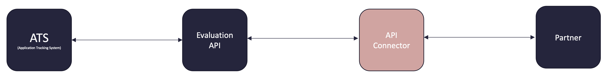
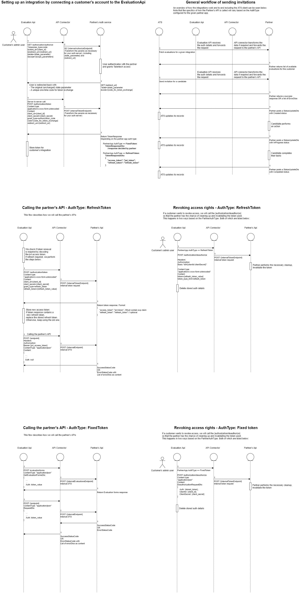

# Getting started
This repository contains documentation and a sample implementation showing how you can use the **Talentech Evaluation API**. The Evaluation API lets you hook into the candidate evaluation flow in any of the Talentech application tracking systems.

The sample implementation is written using C# and ASP.NET and can be used as starting point or inspiration when integrating with the Evaluation API. Run the project locally in order to view OpenAPI docs, which is served at the default route.

The API connector must be hosted in your cloud environment and is the connector between the Talentech ATSes and your infrastructure as shown in the high level illustration below.




## Announcements and system status
To stay up to date about API changes and other announcements about Evaluation API, you can watch this repo. We use the [Discussions](https://github.com/Talentech/EvaluationApi/discussions) to post announcements.

You can also subscribe to [Talentech's status page](https://status.talentech.info) to be notified about incidents.

## Key terms
- Evaluation API - The Talentech app partners will integrate with
- Partner App - The existing app managed by the partner.
- ATS - Application Tracking System. The source system triggering the invitation.
- API Connector - A facade API controlled by the Partner. This is what will connect the Evaluation API and the Partner App's APIs. 
- Invitations - An invitation for a candidate. This will be sent from the Evaluation API to the API connector
- Results - Status updates and results for an invitation (reference check, assessment test, background check, contract or feedback). These are posted from the API connector back to the Evaluation API
- ApiBaseUrl - The base url of the Api Connector. This is used to resolve the endpoints the Evaluation API expects the API connector to make available.
- Evaluation API base URL - The base URL for calling the Evaluation API, given to you by Talentech, for example `https://<host>/api`. Paths in these docs, such as `/v1/Results`, are relative to it.
- Talentech token endpoint - The endpoint you get access tokens from when you call the Evaluation API, given to you by Talentech together with your client id and client secret.

# What is needed to integrate
The endpoints below must be implemented by a partner in order to integrate with the Talentech Evaluation API. 
- Invitations endpoint
- Health check endpoint
- Evaluations endpoint
  - [Custom field support](docs/custom-fields.md)
- Authorization endpoints (See the OAuth section below)

The relative URLs implemented by the partners can be found in [src/Config/Constants.cs](src/Config/Constants.cs). The invitations, health check and evaluations endpoints are relative to your ApiBaseUrl. The authorization endpoints are set in your app configuration (an auth server base URL and a path for each), so the paths in the sample are only an example.

## Optional endpoints you can call
- [Checking what a user may see](docs/permissions.md) - ask, per invitation, which permissions a given user holds in the ATS.

## Payload casing
Every payload the Evaluation API sends you (invitations, evaluation forms requests and deauthorization requests) uses **PascalCase** property names (`InvitationId`, `EvaluationDetails`, `CandidateId`), as in [docs/payload-examples/invitation.json](docs/payload-examples/invitation.json). Missing values arrive as `null`. Some ATSes send empty strings instead. In Fixed token mode, `Auth` holds the same JSON your token endpoint returned (see [OAuth](#oauth)).

Our own endpoints accept either casing on what you send us, and enum values as the number or the name.

## Posting results
Post status updates and results to `POST {Evaluation API base URL}/v1/Results` with `Content-Type: application/json`. Authenticate with an access token from the Talentech token endpoint: request it with the OAuth 2.0 client credentials grant (`grant_type=client_credentials`, `client_id`, `client_secret`) and send it as `Authorization: Bearer <token>`. The token is issued for the Evaluation API, as agreed during onboarding. [EvaluationApiClient.cs](src/Services/Clients/EvaluationApi/EvaluationApiClient.cs) and [TokenClient.cs](src/Services/Clients/AccessTokens/TokenClient.cs) show how this can be done in .NET.

The body, as in [docs/payload-examples/results.json](docs/payload-examples/results.json):
- `InvitationId` (required): the `InvitationId` from the invitation.
- `Status` (required): `1` Created, `2` InProgress, `3` Completed, `4` Expired, `5` Failed, `6` Rejected. Send the number or the name.
- `Message`, `Description`: free text for the ATS.
- `Score`: a string. A JSON number is rejected.
- `ReportUrls` (optional): a list of `Name`, `Type` (`0` WebPage, `1` PdfDownload), `Uri` and `EncryptedFields`. Leave `EncryptedFields` out or empty, or send `["Uri"]` when `Uri` is encrypted (see [encryption](docs/encryption.md)). Never send it as `null`.
- `ScoreProfiles` (optional): a list of `Id` and `Score` (a number), see [score profiles](docs/score-profiles.md).

Our answers:
- `200`: the update was accepted.
- `400`: the body could not be read, for example `Score` sent as a number or `EncryptedFields` sent as `null`. Correct the body before you send it again.
- `401`: the access token is missing or not valid.
- `404`: there is no invitation with that id. Do not retry.
- `410`: the integration has been archived, and no more updates are needed for this invitation.

For any other error, send the update again later (see [Retry policies](#retry-policies)).

# OAuth
The OAuth2.0 authorization_code grant is supported by the Evaluation API and is a mandatory requirement for partners who wish to integrate. 

The Api connector should implement the following endpoints in the API connector:
- AuthorizationEndpoint 
- TokenEndpoint
- DeauthorizationEndpoint

These will typically be simple proxy endpoints that route the request on to a backend OAuth service managed by the partner. 

The workflow for granting the Evaluation API access to the PartnerApp's resources works as follows:

- When an ATS customer subscribes to a partner integration, we will need to get their authorization details in order to access their data in the Partner's API on their behalf. 
- This is done by redirecting an admin user from the customer to the Authorization endpoint (which is managed by the Partner), with `client_id`, `response_type=code`, `redirect_uri`, `state` and, when your app has scopes configured, `scope` in the query string.
- At the authorization endpoint, the customer's user will authenticate themselves, as well as grant the Talentech app the required permissions.
- Once done, the user must be redirected back to the EvaluationApi's redirect_uri, with the authorization `code` and the unchanged `state` as query string parameters.
- When the user hits the Evaluation API's redirect_uri endpoint, an API call will be made to exchange the authorization code for a token.

The {evaluation_api_redirect_uri} is a parameter that should be validated by the partner api. The URL is as follows:
https://evaluation.talentech.io/Customers/OAuth/Callback

We currently support the following token types: "Refresh token" and "Fixed token". 
- Refresh tokens are tokens we will use to retrieve new access tokens from the partner if the existing access token is about to expire. Your token endpoint must return `access_token` and `refresh_token`, and the access token must be a JWT with an `exp` claim. We send it as `Authorization: Bearer <access_token>`, and `Auth` is `null`. Before the access token expires, we call your token endpoint with `grant_type=refresh_token`, `refresh_token`, `client_id` and `client_secret`. That response must also contain both `access_token` and `refresh_token` (the refresh token may be the same as before).
- Fixed tokens are permanent tokens that will be stored and used as-is. An example of this would be an API key. We send the same JSON your token endpoint returned in the `Auth` property of every call we make to you, so that response must be valid JSON. No Authorization header is sent.

When a customer disconnects the integration, we call your deauthorize endpoint. For a Fixed token app this is a JSON body with `TriggeredBy`, `Auth`, `ClientId` and `ClientSecret`. For a Refresh token app it is a form post with `token` (the refresh token) and `token_type_hint=refresh_token`, authenticated with HTTP Basic (`client_id:client_secret`). The response is not used.

Please note that the samples in the repository currently implement the Fixed token mode.

# Error handling
An invitation counts as accepted when your API connector answers with any 2xx status, and the body of that answer is not read. For the evaluation forms call, the body of a 2xx answer must carry your forms (see [custom fields](docs/custom-fields.md#rules-for-the-response)).

When an invitation or evaluation forms call fails, answer with a non-2xx status and a JSON array like this:

```json
[
  { "ErrorType": 1, "Message": "Text that may be shown to the ATS user" },
  { "ErrorType": 0, "Message": "Technical detail for the ATS and Talentech support" }
]
```

- `ErrorType` must be a number: `0` SystemError, `1` UserError. Property names are case-insensitive.
- SystemError messages are technical details for the ATS and Talentech support, not for end users.
- UserError messages may be shown to end users.

We pass your HTTP status code and the first message of each type on to the ATS. If the body is not in this format, the ATS gets generic messages instead.

# Correlation id
Every call the Evaluation API makes to your API connector carries an `X-Correlation-ID` header. You may also send one on the calls you make to us (`/results`, `/permissions`): a value of 1 to 64 characters from `A-Z`, `a-z`, `0-9`, `.`, `_` and `-` is kept as is, anything else is replaced. The id comes back in the same header on every response. Quote it when you contact Talentech support about a specific call, so we can find that request in our logs.

# Retry policies
When results are posted back to Talentech by the partner, the Evaluation API will act as a gateway and forward the data to the ATS that sent the invitation. As the API calls may occasionally fail, it's important that the partner implements retry policies to ensure that the customer eventually receives their data. The retry policy should include an exponential backoff to prevent overloading the API. [Posting results](#posting-results) lists the answers that should not be retried.

We may send the same invitation more than once, for example after a timeout. Use `InvitationId` to recognise an invitation you already have, and answer promptly.

# Sequence diagrams
Below is a description of the flows we support. The one we'll use for a given partner's app is governed by the token type (Fixed or Refresh token) configured for the app in question.




# Language Support

When using the Evaluation API there are a couple of things to consider when it comes to language support and localization. 

1. You as a partner might provide assessment tests or reference check forms in different languages. You can either choose to have multi-lingual support in a single test/form and describe a list of the supported languages, or you could provide different tests/forms for each language.

2. When an invitation is triggered from an ATS, we will provide information about the preferred language for each candidate.

The business logic for picking the right language when sending the actual invitations to the candidate must be placed in the API Connector.

## Returning language preferences for each evaluation form
When we call the `/evaluationforms` in the partner's API Connector, you as a partner can return all your available assessment tests or reference check forms. Each entry you return, can have an array with supported languages. 

```json
[
  {
    "id": "8763f39e-0552-4ea0-b75d-6cba86d03166",
    "name": "My Assessment Test",
    "languages": [
      {
        "name": "English",
        "languageCode": "en"
      },
      {
        "name": "Norwegian",
        "languageCode": "nb-NO"
      }
    ],
    "description": "This is an example assessment test"
  }
]
```

## Choosing language for candidate invitations
When the ATS triggers an invitation to the API Connector, we include `EvaluationDetails.PreferredLanguage`. This field contains the preferred language in which the candidate would like to receive emails, see UI or any other language specific content. You as a partner need to use this `PreferredLanguage` when sending email invitations, picking the right language version of the test/form or any other language related content you might have.

```json
{
  "Version": 1,
  "EvaluationDetails": {
    "InvitationId": "3fa85f64-5717-4562-b3fc-2c963f66afa6",
    "EvaluationFormId": "string",
    "ProjectId": "string",
    "ProjectName": "string",
    "CandidateId": "string",
    "FirstName": "Jane",
    "LastName": "Doe",
    "Email": "jane.doe@example.com",
    "PhoneNumber": "+46701740605",
    "PreferredLanguage": "en",
    "NoteToCandidate": "string"
  }
}
```

This example is shortened. The full payload is in [docs/payload-examples/invitation.json](docs/payload-examples/invitation.json).

## Language codes
`PreferredLanguage` comes from the ATS unchanged. It is usually a two-letter ISO 639-1 code (`en`, `nb`, `sv`, `da`), but it can include a region (`nb-NO`, `en-US`, `en-GB`). If you use a different format for your language codes, map our codes to yours in the API Connector.

## Supported languages in Talentech
|Language|Code|Talent Recruiter|ReachMee|Webcruiter|
---------|----|----------------|--------|----------|
|English|en|x|x|x|
|Norwegian bokmål|nb|x|x|x|
|Swedish|sv|x|x|x|
|Danish|da|x|x|x|


# Versioning and backwards compability

We consider adding new fields to payloads we post and payloads we receive as non-breaking changes.
Changes to the APIs are announced in the [announcements section](https://github.com/Talentech/EvaluationApi/discussions/categories/announcements).
