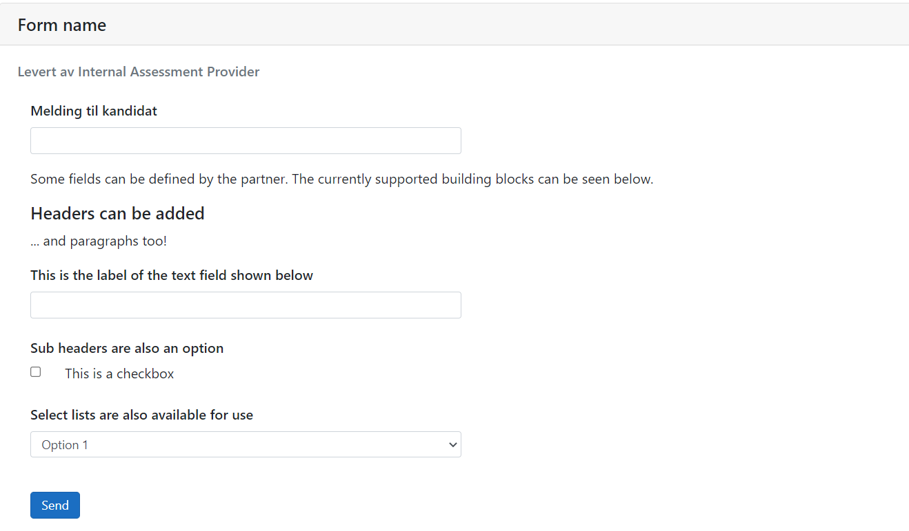

# Evaluation API custom fields
The `/evaluationforms` endpoint of your API connector can describe custom fields that the ATS renders for an evaluation form.

Currently we support the following types of custom fields:
- [Select list](#select-list)
- [Checkbox](#checkbox)
- [Text input](#text-input)
- [Paragraph](#paragraph)
- [Header](#header)
- [Subheader](#subheader)

All custom fields go in the `customFields` array of each evaluation form you return.

All custom fields share the following properties:
- `id`, unique identifier for the custom field.
- `disabled`, indicating whether to render the custom field or not.
- `label`, the display label rendered for the custom field.
- `type`, required. It must be exactly one of `select`, `checkbox`, `text`, `paragraph`, `header` or `subheader` (lowercase).

In addition to these there are type-specific properties.

The array of custom fields is _ordered_, that means that the content is displayed in order of its index, and this allows creating sections and subsections of content. See the [full example](#full-example).

## Rules for the response
The Evaluation API reads your whole response at once. One field that breaks a rule below makes the whole response unreadable, and the ATS gets an error instead of your forms.
- The response is a JSON array. An empty array is fine.
- Every custom field has a `type` from the list above. Any other value, a different casing or a missing `type` breaks the response.
- The key that holds the type is named `type` (or `Type`).
- `disabled` and the `value` of a checkbox are `true` or `false`, never `null`.
- A select list always has `options`.
- The forms array and the `customFields`, `languages`, `scoreProfiles` and `options` arrays contain no `null` entries.

Property names are case-insensitive, and properties we do not know are ignored.

## Select list
The select list is well suited for showing single choices in the ATS.

It has `options`, an array consisting of `Option`s (required, it may be empty). An `Option` has an `id` property and a `label` property used for the same purposes as described above. The select list can also have a `value`, the `id` of the option to show as selected.

The type property should have the value `"select"`.

```jsonc
{
    "id": "unique-string-id-for-custom-select-list",
    "disabled": false,
    "label": "Display label for select list",
    "type": "select",
    "value": "unique-string-id-for-option",
    "options": [
        {
            "id": "unique-string-id-for-option",
            "label": "Display label for option"
        }
    ]
}
```

## Checkbox
Checkboxes are well suited for providing additional "multiple choice" inputs to the evaluation form.

A checkbox should contain a single extra property, `value`, a boolean where `true` represents the checkbox being checked, and `false` represents it being unchecked.

The type property should have the value `"checkbox"`.

```jsonc
{
    "id": "unique-string-id-for-custom-checkbox",
    "disabled": false,
    "label": "Display label for checkbox",
    "type": "checkbox",
    "value": true
}
```
## Text input
Text inputs are suited for comments (responses, names of things, feedback).

Text inputs contain a single extra property, `value`, a string representing the text entered into the text input.

The `type` property should have the value `"text"`

```jsonc
{
    "id": "unique-string-id-for-custom-text-input",
    "disabled": false,
    "label": "Display label for text input",
    "type": "text",
    "value": "Insightful comment, answer or other kind of textual feedback."
}
```

## Paragraph
Paragraphs are suited for descriptions or explanations.

A paragraph does not contain any extra properties, and its label determines its content.

The `type` property should have the value `"paragraph"`

```jsonc
{
    "id": "unique-string-id-for-custom-paragraph",
    "disabled": false,
    "label": "Incredibly informative and helpful description of something pertaining to the evaluation form.",
    "type": "paragraph"
}
```

## Header
Headers are suited for descriminating between sections of content.

A header does not contain any extra properties, and its label determines its content.

The `type` property should have the value `"header"`.

```jsonc
{
    "id": "unique-string-id-for-custom-header",
    "disabled": false,
    "label": "Best Title",
    "type": "header"
}
```

## Subheader
Subheaders are suited for dividing up content within a section.

A subheader does not contain any extra properties, and its label determines its content.

The `type` property should have the value `"subheader"`.

```jsonc
{
    "id": "unique-string-id-for-custom-subheader",
    "disabled": false,
    "label": "Best Title",
    "type": "subheader"
}
```

## Full example
```jsonc
[
    {
        "id": "id-from-partner-1",
        "name": "Form name",
        "languages": [],
        "description": "string",
        "customFields": [
            {
                "id": "paragraph-1",
                "type": "paragraph",
                "label": "Some fields can be defined by the partner. The currently supported building blocks can be seen below."
            },
            {
                "id": "header-1",
                "type": "header",
                "label": "Headers can be added"
            },
            {
                "id": "paragraph-2",
                "type": "paragraph",
                "label": "... and paragraphs too!"
            },
            {
                "id": "text-input-1",
                "type": "text",
                "disabled": false,
                "label": "This is the label of the text field shown below"
            },
            {
                "id": "subheader-1",
                "type": "subheader",
                "label": "Sub headers are also an option"
            },
            {
                "id": "checkbox-1",
                "type": "checkbox",
                "disabled": false,
                "label": "This is a checkbox",
                "value": false
            },
            {
                "id": "select-1",
                "label": "Select lists are also available for use",
                "disabled": false,
                "type": "select",
                "value": "option-1",
                "options": [
                    {
                        "id": "option-1",
                        "label": "Option 1"
                    },
                    {
                        "id": "option-2",
                        "label": "Option 2"
                    }
                ]
            }
        ]
    }
]
```
will result in the following rendering of the form:



## Values in the invitation
What the user enters comes back in the invitation, in `EvaluationDetails.CustomFieldValues`, as entries like `{ "Id": "<id of the custom field>", "Value": "<string>" }`. The value is always a string: the `id` of the chosen option for a select list, the entered text for a text input, and for a checkbox `"true"` or `"false"` as the ATS sent it. Some ATSes send `"True"` or `"False"`, so compare checkbox values without regard to case.